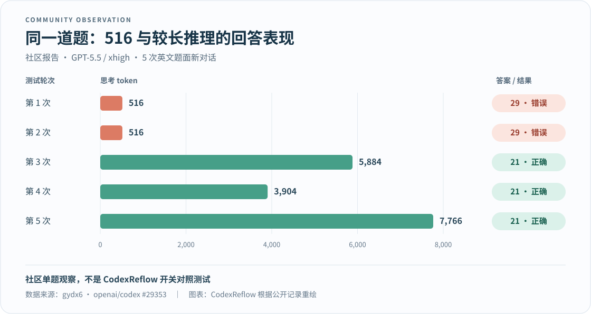

# Reflow · 续流

**简体中文** · [English](README_EN.md)

**应对 GPT 思维链截断带来的降智，让推理继续。**

GPT 很快交出答案，却像没想透；查看用量，又反复停在 `516、1034、1552……` 这些数字上。Reflow 针对这类可疑现象，尝试自动让模型再想一轮，再把最终回答交回给你。

你继续使用原来的客户端、模型和登录账号，不用每次手动追问“再想想”。Reflow 既能作为 CPA 插件使用，也能独立配合 Codex、Pi 和 Magpie。

[独立版 dev.6（预发布）](https://github.com/chatwithgod/reflow/releases/tag/v0.1.0-dev.6) · [CPA 版 0.1.4（预发布）](https://github.com/chatwithgod/reflow/releases/tag/v0.1.4) · [反馈问题](https://github.com/chatwithgod/reflow/issues)

## 它能做什么？

- **自动接力思考**：遇到符合规则的响应，尝试追加思考，不用手动催它继续。
- **继续用原来的客户端**：支持原生登录的 Codex，也提供 Pi、Magpie 接入方式。
- **两种安装方式**：用 CPA 的装插件；不用 CPA 的运行独立程序。
- **保留工具调用**：中间被舍弃的工具调用不会交给客户端执行，最后保留的工具调用正常返回。

> 多想一轮会增加等待时间和模型用量。`516` 等数字只是判断线索，不能单凭它认定回答有问题；续接也不保证每次都能提高质量。

## 安装与使用

### 我用 Codex 原生 ChatGPT 登录

下载独立程序，解压后启动，再让 Codex 通过它发请求。下面以 Windows 为例。

**1. 下载并启动。** 下载 [Windows x64 独立包](https://github.com/chatwithgod/reflow/releases/download/v0.1.0-dev.6/reflow_0.1.0-dev.6_windows_amd64.zip)，在解压后的文件夹中打开 PowerShell：

```powershell
.\reflow.exe -max-continue 1
```

保持这个窗口打开。这个示例最多自动补想一次。

**2. 接入 Codex。** 在同一个文件夹另开一个 PowerShell 窗口，先预览要改的设置：

```powershell
.\reflow.exe codex-config --action preview
```

确认后接入：

```powershell
.\reflow.exe codex-config --action connect
```

**3. 重启 Codex，照常聊天。** 原来的 ChatGPT 登录继续使用。运行 Reflow 的窗口需要保持打开。

<details>
<summary>macOS / Linux 下载与命令</summary>

| 系统 | 下载 |
| --- | --- |
| macOS Apple Silicon | [独立包](https://github.com/chatwithgod/reflow/releases/download/v0.1.0-dev.6/reflow_0.1.0-dev.6_darwin_arm64.zip) |
| macOS Intel | [独立包](https://github.com/chatwithgod/reflow/releases/download/v0.1.0-dev.6/reflow_0.1.0-dev.6_darwin_amd64.zip) |
| Linux x64 | [独立包](https://github.com/chatwithgod/reflow/releases/download/v0.1.0-dev.6/reflow_0.1.0-dev.6_linux_amd64.zip) |
| Linux ARM64 | [独立包](https://github.com/chatwithgod/reflow/releases/download/v0.1.0-dev.6/reflow_0.1.0-dev.6_linux_arm64.zip) |

在解压目录启动 `./reflow -max-continue 1`，保持运行；另开终端依次执行以下命令，然后重启 Codex：

```sh
./reflow codex-config --action preview
./reflow codex-config --action connect
```

这些是预发布包。各平台实际测试情况与已知限制见[开发与验证](docs/DEVELOPMENT.md)。

</details>

如果想在 Codex 里用插件预览、接入和还原配置，可以选择同一发布页中的 `reflow_plugin_…` 包，按[插件说明](plugins/codex/README.md)安装。**安装插件后仍需启动代理程序。**

### 我用 CPA / ECPA

继续在插件商店安装稳定版即可：

1. 打开「插件 → 插件商店」，搜索 **CodexReflow**。
2. 安装后，在本地插件列表中启用它。
3. 照常使用客户端。全新配置默认会匹配 GPT 文本模型，一般不需要手写模型名单。

商店当前仍提供旧仓库的稳定版 `v0.1.3`。本仓库的 [CPA 0.1.4](https://github.com/chatwithgod/reflow/releases/tag/v0.1.4) 是合并源码后的预发布版，需单独下载；商店入口尚未迁移。

如果已经启用了 CodexComp，请先停用它，避免两个插件同时接管同一请求。使用 CPA 插件时，不需要再套一层独立 Reflow。配置选项见[CPA 使用说明](adapters/cpa/docs/CONFIGURATION.md)。

### 我用 Pi / Magpie

下载独立程序，再按对应说明接入：[Pi](adapters/pi/README.md) · [Magpie](adapters/magpie/EXTERNAL.md)。它们的登录方式、接入步骤和已测版本分别写在说明里。

## 为什么关注“516 降智”？

有时回答变差，看起来像模型没想清楚就急着交卷。社区发现，一部分这样的响应，思考用量恰好停在 `516、1034、1552……`。这些数字每次增加 518，可以写成 `518n−2`。

Reflow 把这类数字当成“可能提前停下”的线索，在上游还允许继续时自动补想。它尝试给推理更多机会，但不能仅凭一个数字判定模型有没有想透。

### 一个直观的社区例子

在 [openai/codex #29353](https://github.com/openai/codex/issues/29353) 中，作者用 `gpt-5.5 / xhigh` 对同一道糖果数学题开了 5 次新对话：两次只用了 **516 个思考 token**，都答错了；另外三次用了 **3,904–7,766 个**，都答对了。

[](https://github.com/openai/codex/issues/29353)

*图表根据社区作者 gydx6 的公开记录重绘。这是单题的 5 次观察，不是 Reflow 开关对照，也不能证明多思考一定答对。*

更大规模的[社区统计 #30364](https://github.com/openai/codex/issues/30364)也记录了固定 token 数值的聚集；作者没有把它当作内部截断机制已经被证实的结论。

### 我们自己的记录里，这种情况多常见？

我们统计了维护者本机 CPA 在 **2026-08-27 至 2026-11-11** 的用量记录，这里只展示 **GPT-6 Astra 和 GPT-6.1 Sol**，排除了失败、取消和预热请求。

**这两个模型共 24,319 次成功生成，其中 3,735 次出现 `518n−2` 特征，占 15.36%。**

| 模型 | 出现次数 / 成功生成次数 | 比例 |
| --- | ---: | ---: |
| `gpt-6-astra` | 3,409 / 22,998 | 14.82% |
| `gpt-6.1-sol` | 326 / 1,321 | 24.68% |
| **两者合计** | **3,735 / 24,319** | **15.36%** |

这里的总次数包含思考用量为 0 的记录。一条聊天可能产生多次生成和续接，因此表里的次数不等于用户发了多少条消息；这些比例也不是模型的“答错率”。

近 30 天的数据、其他统计口径和复现方法放在[完整统计说明](docs/REASONING-PATTERN-2026-11-12.md)，原始账号和聊天内容没有公开。

## 常见问题

### 用上以后，为什么还会看到 516？

续接是在原来那一轮后面再追加一轮，不会把第一轮的用量记录删掉。下一轮也可能直接作答，没有增加思考用量，所以总数仍可能是 516。

判断是否起作用，要看有没有实际追加请求、最后是否正常完成，再看回答是否对你有帮助。排查方法见[独立版诊断](docs/DECISION-DIAGNOSTICS.md)和[CPA 诊断](adapters/cpa/docs/DIAGNOSTICS.md)。

### 会多花多少用量？

每次追加都会多发一个模型请求。最多追加几次由设置决定，默认上限是 3 次；上面的独立版安装示例把它限制为 1 次。不是每条消息都会追加，次数多也不等于回答一定更好。

### 不想用了，怎么恢复？

独立版用户先还原 Codex 设置：

```powershell
.\reflow.exe codex-config --action restore
```

然后重启 Codex，再关闭 Reflow 窗口。macOS / Linux 将 `.\reflow.exe` 换成 `./reflow`。CPA 用户可在插件列表中停用 CodexReflow。

### 启动了，但 Codex 连不上怎么办？

先确认 Reflow 的窗口还开着。如果本机访问 OpenAI 需要网络代理，Reflow 进程也需要设置 `HTTP_PROXY` / `HTTPS_PROXY`，并让 `NO_PROXY` 包含本机回环地址；它不会自动读取 Windows 系统代理。

如果使用的不是 Codex 内置的登录方式，自动接入命令可能拒绝修改设置。请按对应客户端的说明接入，或[提交脱敏后的错误信息](https://github.com/chatwithgod/reflow/issues)。

## 数据与隐私

为了续接，Reflow 会在内存中临时保留上下文和上游返回的推理状态。独立版继续由客户端管理登录，不读取 `auth.json`；默认诊断不会记录提示词、回答或登录凭据。CPA 宿主及其他插件的日志由各自配置决定。

## 更多文档

- [独立版 Codex 插件](plugins/codex/README.md) · [Pi 接入](adapters/pi/README.md) · [Magpie 接入](adapters/magpie/EXTERNAL.md)
- [CPA 配置](adapters/cpa/docs/CONFIGURATION.md) · [统计口径与数据](docs/REASONING-PATTERN-2026-11-12.md)
- [已测平台、已知限制与开发方法](docs/DEVELOPMENT.md) · [真实登录验收记录](docs/NATIVE-LOGIN-ACCEPTANCE.md)

当前独立版 dev.6 和 CPA 0.1.4 都是预发布版。具体测试结果与未覆盖的范围集中在上述文档中。

## 来源、致谢与许可证

Reflow 从 [CPA CodexReflow](https://github.com/chatwithgod/cpa-plugin-codexreflow) 发展而来，沿用以下上游项目的代码与探索：

- [uf-hy / CPA CodexComp](https://github.com/uf-hy/cpa-plugin-codexcomp)：CPA 插件的直接上游。
- [dzshzx / codexcomp](https://github.com/dzshzx/codexcomp)：响应合并与续接算法。
- [neteroster / CodexCont](https://github.com/neteroster/CodexCont)：`518n−2` 识别与推理续接机制。

感谢以上项目及其作者。Reflow 独立维护，非 OpenAI 或 CLIProxyAPI 官方项目。采用 [MIT 许可证](LICENSE)，保留原作者的版权和许可；完整来源见[第三方声明](THIRD_PARTY_NOTICES.md)。
