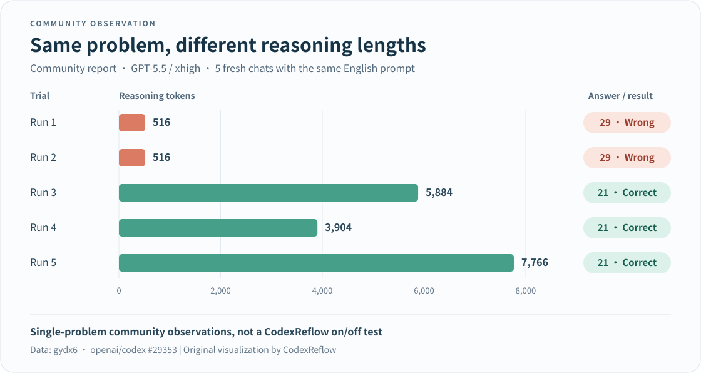

# Reflow

[简体中文](README.md) · **English**

**Address quality loss from GPT chain-of-thought truncation and keep reasoning going.**

We have observed that GPT reasoning token counts often stop at `516`, `1034`, `1552`, and so on. Reflow responds to this pattern by asking the model to think for another round, then returns the final answer to you.

Keep using your existing client, model, and account without manually asking it to “think again.” Reflow works as a CPA plugin or as a standalone program for Codex, Pi, and Magpie.

[Standalone dev.6 (prerelease)](https://github.com/chatwithgod/reflow/releases/tag/v0.1.0-dev.6) · [CPA 0.1.4 (prerelease)](https://github.com/chatwithgod/reflow/releases/tag/v0.1.4) · [Report a problem](https://github.com/chatwithgod/reflow/issues)

## What does it do?

- **Continue reasoning automatically**: When a response matches the rules, Reflow attempts another round without a manual follow-up.
- **Use your existing client**: Supports Codex with native ChatGPT sign-in, with adapters for Pi and Magpie.
- **Choose how to install it**: Use the plugin with CPA, or run the standalone program without CPA.
- **Preserve tool calls**: Discarded intermediate tool calls are not sent to the client for execution. Calls from the retained response are returned normally.

> Extra rounds take time and consume additional model usage. Counts such as `516` are clues, not proof that an answer is flawed. Continuation does not guarantee better quality.

## Installation and use

### I use Codex with native ChatGPT sign-in

Download and start the standalone program, then configure Codex to send requests through it. The following example is for Windows.

**1. Download and start Reflow.** Download the [Windows x64 standalone package](https://github.com/chatwithgod/reflow/releases/download/v0.1.0-dev.6/reflow_0.1.0-dev.6_windows_amd64.zip), extract it, and open PowerShell in that folder:

```powershell
.\reflow.exe -max-continue 1
```

Keep this window open. This example permits at most one extra round per request.

**2. Connect Codex.** Open another PowerShell window in the same folder and preview the configuration changes:

```powershell
.\reflow.exe codex-config --action preview
```

After reviewing the preview, connect:

```powershell
.\reflow.exe codex-config --action connect
```

**3. Restart Codex and use it as usual.** Keep your existing ChatGPT sign-in. The Reflow process must remain running.

<details>
<summary>macOS / Linux downloads and commands</summary>

| Platform | Download |
| --- | --- |
| macOS Apple Silicon | [Standalone package](https://github.com/chatwithgod/reflow/releases/download/v0.1.0-dev.6/reflow_0.1.0-dev.6_darwin_arm64.zip) |
| macOS Intel | [Standalone package](https://github.com/chatwithgod/reflow/releases/download/v0.1.0-dev.6/reflow_0.1.0-dev.6_darwin_amd64.zip) |
| Linux x64 | [Standalone package](https://github.com/chatwithgod/reflow/releases/download/v0.1.0-dev.6/reflow_0.1.0-dev.6_linux_amd64.zip) |
| Linux ARM64 | [Standalone package](https://github.com/chatwithgod/reflow/releases/download/v0.1.0-dev.6/reflow_0.1.0-dev.6_linux_arm64.zip) |

Start `./reflow -max-continue 1` in the extracted folder and keep it running. In another terminal, run these commands, then restart Codex:

```sh
./reflow codex-config --action preview
./reflow codex-config --action connect
```

These are prerelease packages. See [development and verification](docs/DEVELOPMENT.md) for actual platform coverage and known limitations.

</details>

To preview, connect, and restore configuration through a Codex plugin, choose a `reflow_plugin_…` package from the same release page and follow the [plugin guide](plugins/codex/README.md). **Installing the plugin still requires you to start the proxy program.**

### I use CPA / ECPA

Install the stable version from the plugin store:

1. Open **Plugins → Plugin Store** and search for **CodexReflow**.
2. Install it, then enable it in your local plugin list.
3. Use your client as usual. Fresh configurations match GPT text models automatically, so you generally do not need to write a model list.

The store currently offers stable `v0.1.3` from the old repository. [CPA 0.1.4](https://github.com/chatwithgod/reflow/releases/tag/v0.1.4) in this repository is a prerelease built from the combined source tree and requires a separate download. The store entry has not been migrated yet.

If CodexComp is enabled, disable it first so that both plugins do not handle the same requests. The CPA plugin does not need an additional standalone Reflow proxy. See the [CPA configuration guide](adapters/cpa/docs/CONFIGURATION.md) for options.

### I use Pi / Magpie

Download the standalone program and follow the relevant guide: [Pi](adapters/pi/README.md) or [Magpie](adapters/magpie/EXTERNAL.md). Each guide explains sign-in, setup, and the versions tested.

## Why watch for reasoning that stops at 516 tokens?

Sometimes an answer seems worse because the model finishes before working through the problem. Community reports have observed some such responses ending at `516`, `1034`, `1552`, and so on. Each number is 518 higher than the previous one, giving the formula `518n−2`.

Reflow uses these counts as clues that reasoning may have stopped early. When the upstream service allows continuation, it tries another round. The goal is to give reasoning more room; a token count alone cannot establish whether the model has thought the problem through.

### A simple community example

In [openai/codex #29353](https://github.com/openai/codex/issues/29353), the author opened five fresh chats with `gpt-5.5 / xhigh` and the same candy math problem. Both runs with **516 reasoning tokens** answered incorrectly. The other three, using **3,904–7,766 reasoning tokens**, answered correctly.

[](https://github.com/openai/codex/issues/29353)

*The chart redraws public observations reported by community author gydx6. These are five trials of one problem, not a Reflow on/off comparison, and they do not prove that more reasoning always produces a correct answer.*

A larger [community analysis, #30364](https://github.com/openai/codex/issues/30364), also reported clustering at fixed token counts. Its author did not treat this as proof of an internal truncation mechanism.

### How often does the pattern appear in our records?

We analyzed the maintainer's local CPA usage records from **2026-08-27 through 2026-11-11**. The figures below cover only **GPT-6 Astra and GPT-6.1 Sol**, excluding failed, canceled, and prewarm requests.

**Across these two models, 3,735 of 24,319 successful generations matched `518n−2`: 15.36%.**

| Model | Occurrences / successful generations | Percentage |
| --- | ---: | ---: |
| `gpt-6-astra` | 3,409 / 22,998 | 14.82% |
| `gpt-6.1-sol` | 326 / 1,321 | 24.68% |
| **Combined** | **3,735 / 24,319** | **15.36%** |

The totals include records with zero reasoning tokens. A single chat can produce several generations and continuation rounds, so these counts are not the number of user messages. The percentages are not model error rates.

The [full statistics and methodology](docs/REASONING-PATTERN-2026-11-12.md) include the last 30 days, other denominators, and reproduction steps. Raw account data and chat contents have not been published.

## Frequently asked questions

### Why do I still see 516 after enabling Reflow?

Continuation adds a round after the original one; it does not delete the first round's usage record. The next round may also produce an answer without adding reasoning tokens, leaving the reasoning total unchanged.

To see whether Reflow ran, check whether it made an extra request and whether the request completed normally. Then assess whether the answer helped. See [standalone diagnostics](docs/DECISION-DIAGNOSTICS.md) and [CPA diagnostics](adapters/cpa/docs/DIAGNOSTICS.md).

### How much extra usage does it consume?

Each continuation makes another model request. The default limit is three additional rounds; the standalone setup example above sets it to one. Not every response triggers continuation, and more rounds do not necessarily improve the answer.

### How do I disconnect it?

For the standalone version, restore Codex's configuration first:

```powershell
.\reflow.exe codex-config --action restore
```

Restart Codex, then close Reflow. On macOS / Linux, use `./reflow` instead of `.\reflow.exe`. CPA users can disable the plugin in the local plugin list.

### Reflow is running, but Codex cannot connect

First check that the Reflow process is still running. If your computer needs a network proxy to reach OpenAI, set `HTTP_PROXY` / `HTTPS_PROXY` for the Reflow process and include loopback addresses in `NO_PROXY`. Reflow does not automatically read Windows system proxy settings.

If you use a sign-in method other than Codex's built-in login, automatic configuration may refuse the change. Follow the relevant client guide or [report the error with sensitive details removed](https://github.com/chatwithgod/reflow/issues).

## Data and privacy

To continue a response, Reflow temporarily holds context and upstream reasoning state in memory. In standalone mode, the client keeps control of sign-in; Reflow does not read `auth.json`. Default diagnostics do not record prompts, answers, or login credentials. Logging by the CPA host or other plugins follows their own configuration.

## More documentation

Most linked technical guides are currently in Chinese.

- [Standalone Codex plugin](plugins/codex/README.md) · [Pi adapter](adapters/pi/README.md) · [Magpie adapter](adapters/magpie/EXTERNAL.md)
- [CPA configuration](adapters/cpa/docs/CONFIGURATION.md) · [Statistics and methodology](docs/REASONING-PATTERN-2026-11-12.md)
- [Tested platforms, known limitations, and development](docs/DEVELOPMENT.md) · [Native sign-in verification](docs/NATIVE-LOGIN-ACCEPTANCE.md)

Standalone dev.6 and CPA 0.1.4 are both prereleases. The guides above describe actual test results and remaining gaps.

## Origins, acknowledgments, and license

Reflow grew out of [CPA CodexReflow](https://github.com/chatwithgod/cpa-plugin-codexreflow), building on code and work from:

- [uf-hy / CPA CodexComp](https://github.com/uf-hy/cpa-plugin-codexcomp): the direct upstream of the CPA plugin.
- [dzshzx / codexcomp](https://github.com/dzshzx/codexcomp): response merging and continuation algorithms.
- [neteroster / CodexCont](https://github.com/neteroster/CodexCont): `518n−2` detection and reasoning continuation mechanisms.

Thanks to these projects and their authors. Reflow is independently maintained and is not an official OpenAI or CLIProxyAPI project. It uses the [MIT license](LICENSE) and retains upstream copyright and license notices. See [third-party notices](THIRD_PARTY_NOTICES.md) for full attribution.
